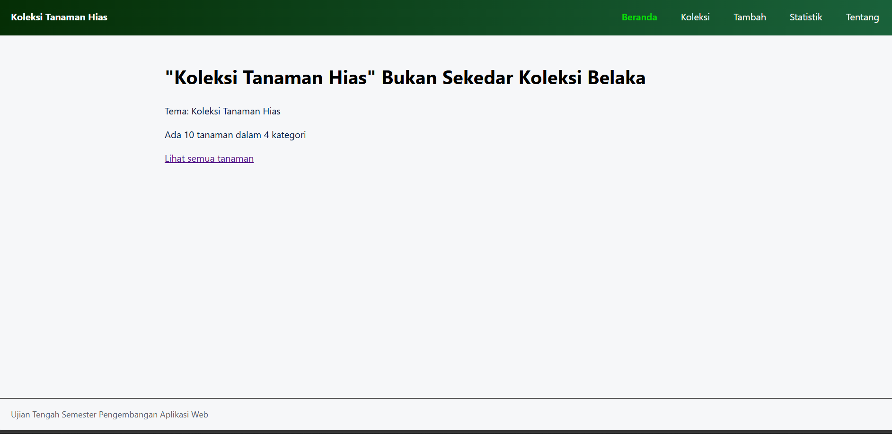
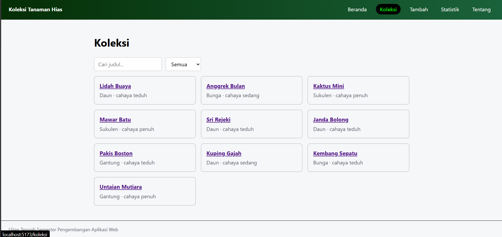
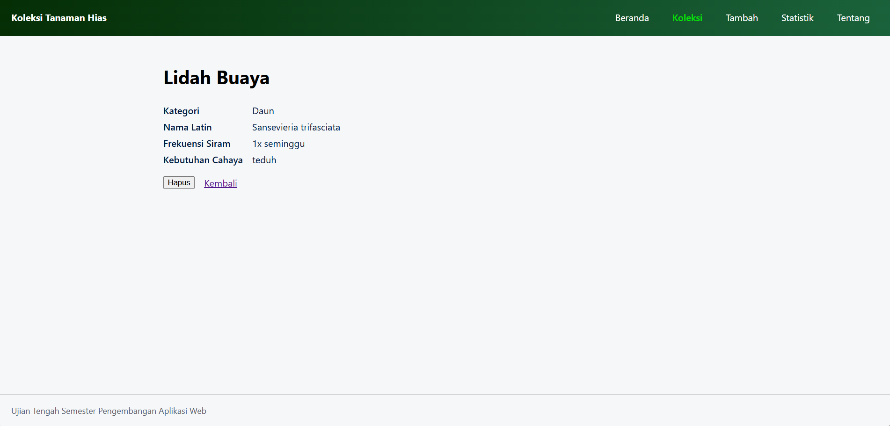
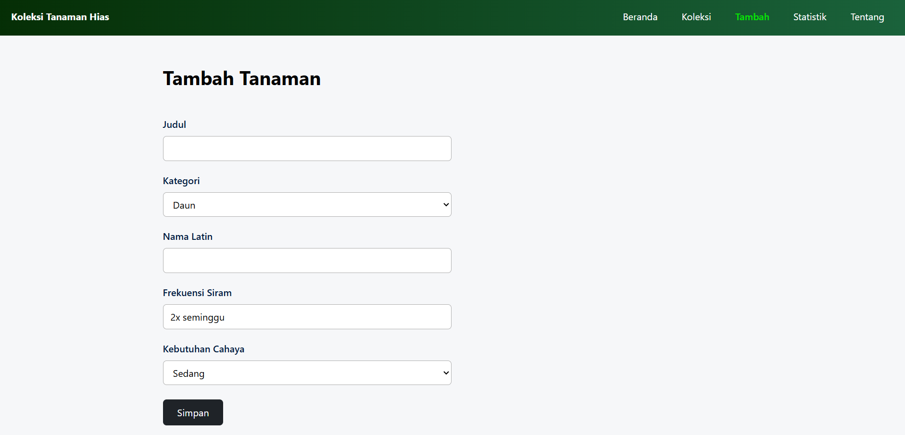
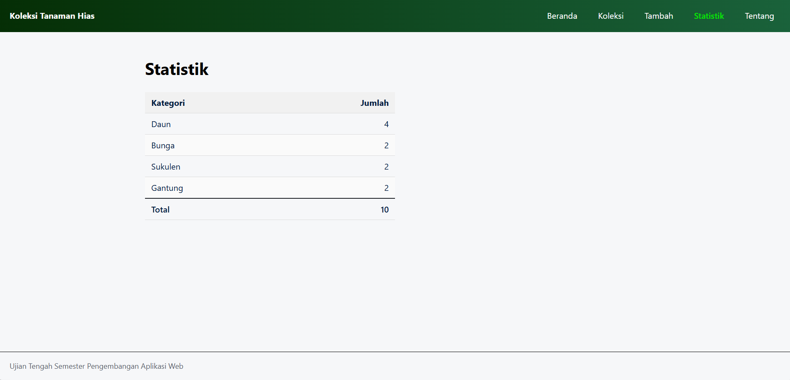
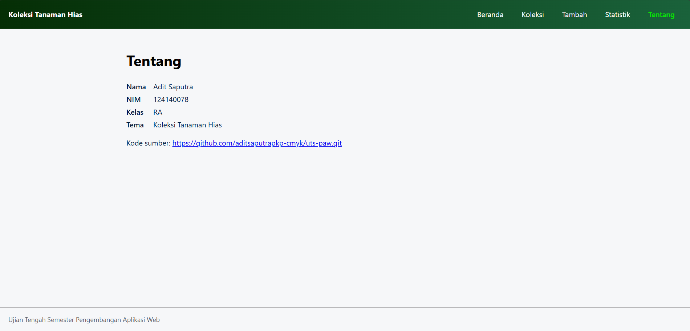

# Ujian Tengah Semester IF25-22014 Pengembangan Aplikasi Web


## Koleksi Tanaman Hias

| Informasi | Detail |
| :--- | :--- |
| **Nama** | Adit Saputra |
| **NIM** | 124140078 |
| **Kelas** | RA |
| **Tema** | Koleksi Tanaman Hias |
| **Deployment** | [aditsaputrapkp-cmyk/uts-paw](https://github.com/aditsaputrapkp-cmyk/uts-paw) |

---

| Halaman Beranda | Halaman Koleksi Tanaman |
| :---: | :---: |
|  |  |
| *Ringkasan koleksi tanaman* | *Daftar tanaman dan alat pencarian* |

| Halaman Detail Tanaman |  Halaman Tambah Tanaman |
| :---: | :---: |
|  |  |
| *Informasi lengkap tanaman* | *Formulir untuk menambahkan tanaman* |

| Halaman Statistik | Halaman Tentang |
| :---: | :---: |
|  |  |
| *Jumlah tanaman per kategori* | *Identitas dan informasi aplikasi* |

---

### Fitur

- Menampilkan ringkasan jumlah tanaman dan kategori pada halaman beranda.
- Menjelajahi koleksi dengan pencarian berdasarkan judul dan filter kategori.
- Membuka detail tanaman, termasuk nama Latin, frekuensi penyiraman, dan kebutuhan cahaya.
- Menambahkan tanaman baru melalui formulir dengan validasi judul.
- Menghapus tanaman dari koleksi.
- Melihat jumlah tanaman pada setiap kategori melalui halaman statistik.
- Menampilkan identitas mahasiswa, tema, dan tautan repositori pada halaman Tentang.

---

## Menjalankan Aplikasi

```bash
cd app
npm install
npm run dev
```

Buka alamat lokal yang ditampilkan oleh Vite di terminal.

Perintah lain yang tersedia:

```bash
npm test       # Menjalankan pengujian
npm run cek    # Memeriksa aplikasi dengan grader lokal
```

---

## Konsep React yang dipakai

- Components dan props untuk membagi tampilan menjadi bagian-bagian yang dapat digunakan kembali.
- useState untuk mengelola input formulir, pencarian, dan filter kategori.
- React Context dan custom hook useKoleksi untuk menyediakan data serta aksi koleksi ke berbagai halaman.
- React Router untuk navigasi aplikasi, termasuk penggunaan Link, useParams, dan useNavigate.